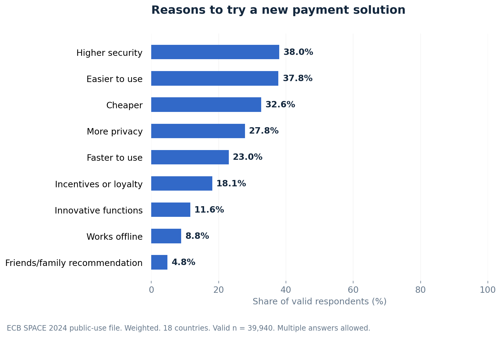

# Customer experience in European payments

**A reproducible Python case study using ECB SPACE 2024 public microdata.**

About 23% of valid respondents reported an in-store technical payment problem
at least once in the past month. About 24% encountered a restriction on their
preferred payment method. Security and ease were almost tied as the most
frequently selected factors that could encourage a new payment solution.

The project turns survey responses into explicit metrics, tests their
definitions, and connects the evidence to operational questions. It includes
an executed notebook, a full findings report and a 10-page LinkedIn PDF.

## Business question

Where do consumers encounter payment friction, and what should a payment
provider investigate or test next?

This is a consumer experience study. The survey does not identify payment
providers, merchant satisfaction with an acquirer, NPS, revenue uplift or
transaction failure rates.

## Headline findings

| Measure | Weighted share | Actual valid n | Reference period |
| --- | ---: | ---: | --- |
| Any in-store technical problem | 23.2% | 39,404 | Past month |
| Preferred method unavailable or restricted | 23.6% | 38,719 | Past month |
| Any online payment difficulty | 18.0% | 13,884 | Diary-day payments |
| Prefer cashless payments when offered a choice | 57.6% | 40,795 | General preference |

Source: European Central Bank, SPACE 2024 public-use file. These are independent
calculations using the supplied Gross_weight and substantive response bases.
The 18-country file excludes Germany and the Netherlands. Czechia is outside
the survey. These percentages are not complete euro-area published estimates.



## Start here

1. Read [the survey guide](docs/survey_guide.md) to understand the questions and coding.
2. Open [the executed notebook](notebooks/01_space_customer_experience.ipynb) to follow the analysis.
3. Read [the case study](reports/case_study.md) for findings, decisions and limitations.
4. Review [the LinkedIn carousel](presentation/space_2024_linkedin_carousel.pdf) and [caption draft](presentation/linkedin_caption.md).

## Reproduce from a clean checkout

Python **3.11 or later** is required. From the project root:

```bash
python -m venv .venv
# Activate .venv using the command for your operating system.
python -m pip install -r requirements.txt
python scripts/run_analysis.py
python -m unittest discover -s tests -v
```

Activate the environment with `source .venv/bin/activate` on macOS/Linux,
or `.venv\Scripts\Activate.ps1` in Windows PowerShell.

The first analysis run downloads the three original ECB source files into
`data/raw/`, verifies the CSV SHA-256, and rebuilds the aggregate tables,
figures, report, PDF and executed notebook. A changed source checksum stops
the build deliberately. Preserve and review changed data before updating it.

If the source cannot be downloaded automatically, obtain the ZIP from the
[official ECB source](https://www.ecb.europa.eu/stats/ecb_surveys/space/shared/pdf/2024_SPACE_microdata.en.zip)
and extract its CSV and two XLSX files into `data/raw/`. The CSV must retain
the name `SPACE Public Use File.csv` and match the checksum in the source code.

To explore the notebook interactively:

```bash
python -m pip install -r requirements-notebook.txt
jupyter lab
```

Open `notebooks/01_space_customer_experience.ipynb` and run all cells.
Charts are prebuilt by the analysis command. Notebook code works from either
the project root or the `notebooks/` directory.

## Repository structure

| Path | Purpose |
| --- | --- |
| `src/space_cx/analysis.py` | Auditable cleaning flags, metric definitions and weighting |
| `scripts/download_data.py` | Source retrieval and byte verification |
| `scripts/run_analysis.py` | One-command build |
| `scripts/build_outputs.py` | Charts, narrative report, executed notebook and PDF |
| `notebooks/01_space_customer_experience.ipynb` | Guided analysis with captured outputs |
| `outputs/tables/` | Full-precision estimates, subgroup tables and audit JSON |
| `outputs/figures/` | Publication charts as PNG and SVG |
| `docs/` | Survey guide, dictionaries and GitHub publishing instructions |
| `reports/case_study.md` | Findings, business implications and limitations |
| `presentation/` | LinkedIn PDF, text and caption draft |
| `tests/test_analysis.py` | Synthetic logic and source regression tests |
| `data/raw/` | Original downloads, excluded from version control and the release ZIP |

## Analytical choices

- Preserve original codes and add explicit `valid_*` flags and nullable outcomes.
- Exclude skipped, unknown and non-substantive responses from each primary base.
- Use an explicit union of respondents for multi-answer “any problem” metrics.
- Use Gross_weight for shares and actual respondent counts for n.
- Round only for communication. Outputs retain additional decimal places.
- Compare weighted with unweighted estimates, inspect survey-mode differences,
  and examine denominator sensitivity and country-standardized age comparisons.
- Avoid causal claims and formal significance tests. Mixed-mode selection and
  unavailable full design information limit precision assessment.

The project uses descriptive analysis deliberately. The survey lacks an
overall satisfaction outcome suitable for a conventional satisfaction-driver
model. A prediction model would not answer the business question better here.

## Validation

Tests check weighted arithmetic, overlapping selections, unknown versus No,
empty groups, invalid weights and duplicate IDs, weight-scale invariance,
source counts, headline estimates, preference partitions and country-weight
reconciliation. The executed notebook reruns the metric calculations. The PDF
was rendered and visually inspected during preparation.

## Sources and attribution

- [Official SPACE page](https://www.ecb.europa.eu/stats/ecb_surveys/space/html/index.en.html)
- [Microdata, codebook and labels](https://www.ecb.europa.eu/stats/ecb_surveys/space/shared/pdf/2024_SPACE_microdata.en.zip)
- [Questionnaire](https://www.ecb.europa.eu/stats/ecb_surveys/space/shared/pdf/ecb.space2024_annex_a.en.pdf)
- [Methodology](https://www.ecb.europa.eu/stats/ecb_surveys/space/shared/pdf/ecb.space2024_annex_b.en.pdf)
- [ECB use and attribution conditions](https://www.ecb.europa.eu/services/using-our-site/disclaimer/html/index.en.html)

Source data: European Central Bank. All outputs are independent calculations
and transformations of the public-use file. The project is not an ECB
publication and implies no ECB endorsement. Original ECB files retain their
source rights and are fetched separately rather than bundled in this release.
